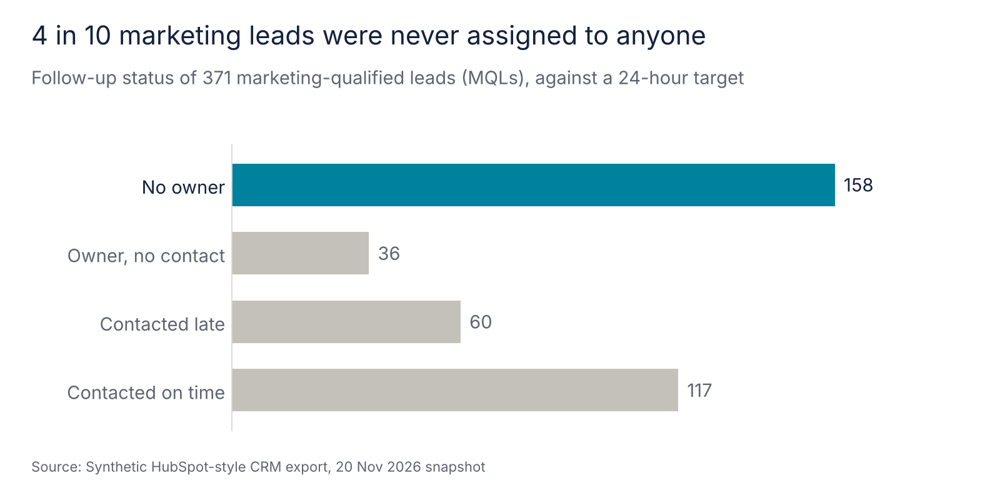
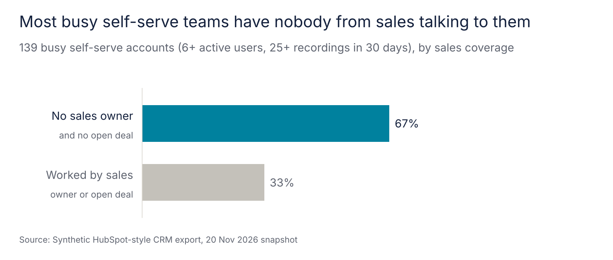

# CRM Data Hygiene Audit: Ferncast

A HubSpot-style CRM audit for a product-led SaaS company: ten SQL checks for duplicates, associations, lifecycle stages, ownership, lead routing and pipeline health, with a prioritized cleanup plan and proposed HubSpot workflows to keep the data clean.

> Ferncast is a fictional video and podcast recording platform with a self-serve product and a sales team for larger accounts. The CRM export is synthetic, with known problems planted at set rates. No real HubSpot account or customer data is used.

## The result

The CRM's biggest problems are routing gaps, not dirty fields. **Most MQLs that missed the 24-hour follow-up SLA were never assigned to anyone**, and **two thirds of the busiest self-serve teams have nobody in sales talking to them**. Meanwhile, 46% of open pipeline is stale, so the forecast is overstated.





## Scorecard

| # | Issue | Affected | Rate |
|---|---|---|---|
| 01 | Likely duplicate contacts | 269 of 6,819 | 3.9% |
| 02 | Likely duplicate companies | 72 of 2,472 | 2.9% |
| 03 | Contacts not linked to their company | 379 of 6,819 | 5.6% |
| 04 | Marked "customer" with no purchase | 57 of 3,957 | 1.4% |
| 05 | SQLs and opportunities with no owner | 200 of 1,148 | 17.4% |
| 06 | Contacts with no lead source | 565 of 6,819 | 8.3% |
| 07 | MQLs not contacted within 24 hours | 254 of 371 | 68.5% |
| 08 | Stale open deals ($2.48M of $5.42M pipeline) | 102 of 222 | 45.9% |
| 09 | Deals with no amount | 31 of 465 | 6.7% |
| 10 | Product-qualified accounts with no sales owner | 93 of 139 | 66.9% |

## What fixing it is worth

| Problem | Size of the prize | Basis |
|---|---|---|
| 93 product-qualified accounts with no sales owner | **$84K to $251K a year** in new deals | Median Pro or Business deal ($18,000) x 5 to 15 extra points of conversion if sales works them (planning assumption) |
| 102 stale open deals | **$2.48M** of the $5.42M forecast is unlikely to close as dated | Close date passed or no activity in 30 days |
| 158 MQLs with no owner | 42.6% of MQLs get no follow-up at all | Every one is a lead the business already paid to create |

The routing fixes come first because they are cheap (a few workflows) and sit closest to revenue. Source: [`results/pql_value_at_stake.csv`](results/pql_value_at_stake.csv), from [`sql/11_pql_value.sql`](sql/11_pql_value.sql)

## Recommendations

1. **Fix routing first:** an MQL assignment workflow and a 24-hour SLA alert, so no lead waits without an owner
2. **Surface product-qualified accounts:** sync product usage to company records, flag busy self-serve teams and route them to sales
3. **Clean the forecast:** a stale deal alert, and Amount and Close date required on later deal stages
4. **Then fix the foundations:** review and merge duplicates, turn on automatic company association, and make lead source required

Detail in the [cleanup plan](docs/02_cleanup_plan.md) and the [proposed HubSpot workflows](docs/03_hubspot_workflow_specs.md).

## What's in the repo

| File | What it shows |
|---|---|
| [docs/01_findings.md](docs/01_findings.md) | Full scorecard and findings, and what I would check first in a real account |
| [docs/02_cleanup_plan.md](docs/02_cleanup_plan.md) | Fix and prevent actions by week, with owners and 30-day targets |
| [docs/03_hubspot_workflow_specs.md](docs/03_hubspot_workflow_specs.md) | Five workflow designs and three settings changes, with plan requirements noted |
| [docs/04_data_dictionary.md](docs/04_data_dictionary.md) | Fields in the synthetic export |
| [sql/](sql/) | One DuckDB query per check |
| [results/](results/) | The scorecard and a record-level list for every check |

## Reproduce

```bash
pip install -r requirements.txt
python src/generate_data.py   # writes the synthetic CRM export to data/
python src/run_analysis.py    # runs every check, writes results/ and images/
```

## Notes on the approach

- **Duplicates are flagged, not merged.** HubSpot already merges exact email matches, so the duplicates left are the same person under a second email, plus a few different people who share a name. A person reviews each pair
- **Rates, not just counts.** Each check has a clear denominator, so it can be tracked weekly as a data health trend
- **Workflow specs are designs.** They are written against HubSpot's documented features and plan requirements, and would be tested in a sandbox before going live

## Skills shown

CRM data quality, HubSpot data model and workflow design, lead routing and SLA design, product-led growth (PQL) operations, pipeline hygiene, SQL (DuckDB), Python, and process documentation.
