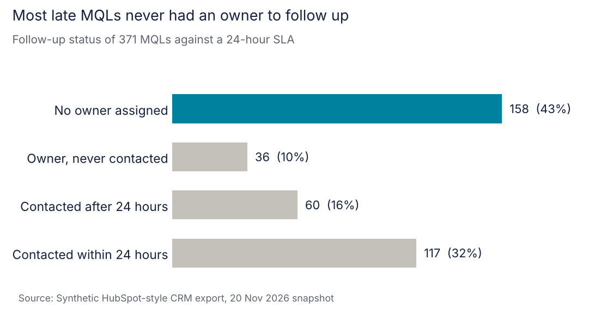
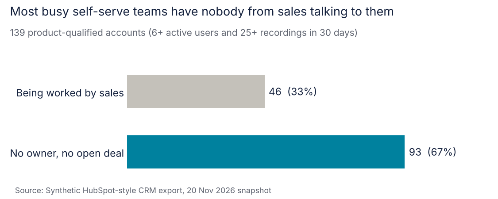

# 01. Audit Findings

**Snapshot:** 20 November 2026 &nbsp;|&nbsp; **Records:** 6,819 contacts, 2,472 companies, 465 deals, 2,045 self-serve workspaces &nbsp;|&nbsp; **Data:** synthetic, see [src/generate_data.py](../src/generate_data.py)

## Scorecard

| # | Area | Issue | Affected | Out of | Rate | What it breaks |
|---|---|---|---|---|---|---|
| 01 | Duplicates | Likely duplicate contacts | 269 | 6,819 contacts | 3.9% | Double-counted leads, split activity history |
| 02 | Duplicates | Likely duplicate companies | 72 | 2,472 companies | 2.9% | Two records for one account, broken account reporting |
| 03 | Associations | Contacts not linked to their company | 379 | 6,819 contacts | 5.6% | Missing from account views, routing and company reporting |
| 04 | Lifecycle | Marked "customer" with no purchase | 57 | 3,957 customer-stage contacts | 1.4% | Inflated customer counts, prospects excluded from sales |
| 05 | Ownership | SQLs and opportunities with no owner | 200 | 1,148 | 17.4% | Nobody accountable for follow-up |
| 06 | Required fields | Contacts with no lead source | 565 | 6,819 contacts | 8.3% | Pipeline cannot be credited to a channel |
| 07 | Routing | MQLs not contacted within 24 hours | 254 | 371 MQLs | 68.5% | Slower follow-up, lower conversion |
| 08 | Pipeline | Stale open deals | 102 | 222 open deals | 45.9% | Forecast includes pipeline nobody is working |
| 09 | Required fields | Deals with no amount | 31 | 465 deals | 6.7% | Left out of pipeline value and forecast |
| 10 | Routing | Product-qualified accounts with no sales owner | 93 | 139 | 66.9% | Expansion revenue left to chance |

Source: [results/scorecard.csv](../results/scorecard.csv). Each row has its own query in [sql/](../sql/) and a record-level file in [results/](../results/).

## Finding 1: most late MQLs never had an owner

| Follow-up status | MQLs | Share |
|---|---|---|
| No owner assigned | 158 | 42.6% |
| Owner, never contacted | 36 | 9.7% |
| Contacted after 24 hours | 60 | 16.2% |
| Contacted within 24 hours | 117 | 31.5% |

Only 31.5% of MQLs were contacted within the 24-hour SLA. The biggest cause is not slow reps: **158 MQLs (62% of the misses) were never assigned to anyone**. That is a routing problem, and it is fixable with an assignment workflow rather than more pressure on the sales team.

## Finding 2: busy self-serve teams are invisible to sales

- 139 self-serve accounts show strong product usage (6+ active users and 25+ recordings in the last 30 days)
- **93 of them (66.9%) have no company owner and no open deal**: 47 on the free plan, 31 on Creator and 15 on Pro
- The median unrouted account has 15 active users, which is a team, not an individual creator

For a product-led company, these are the warmest expansion leads in the database, and nothing in the CRM currently surfaces them. At the median Pro or Business deal of $18,000, every 5 points of extra conversion from sales outreach is worth about $84,000 a year ([`results/pql_value_at_stake.csv`](../results/pql_value_at_stake.csv)).

## Finding 3: almost half the open pipeline is stale

- 102 of 222 open deals (45.9%) have a close date in the past, no activity in 30 days, or both
- They carry **$2.48M of the $5.42M open pipeline** (45.8%)
- 54 have a past close date, 61 have had no activity in 30 days, and 13 have both

The forecast is overstated until these are updated or closed out.

## Finding 4: smaller gaps that compound

- **Ownership:** 200 SQLs and opportunities (17.4%) have no contact owner
- **Lead source:** 565 contacts (8.3%) have none, so channel reporting undercounts every source
- **Associations:** 379 contacts (5.6%) use a company email domain that already exists in the CRM but are not linked to that company
- **Duplicates:** 269 likely duplicate contacts, 248 of them a second record created with a personal email (Gmail or Outlook) during a product signup. The other 21 are different people who share a name at the same company, which is why duplicates need a human review rather than a bulk merge
- **Duplicate companies:** 72 created from a subdomain (for example app.example.com) alongside the main domain
- **Lifecycle:** 57 contacts marked "customer" at free-plan companies with no closed-won deal
- **Deal amounts:** 31 deals (6.7%) have no amount

## What I would check first in a real account

This audit uses synthetic data. In a live HubSpot account I would confirm three things before changing anything:

1. **Definitions:** how this team defines an MQL, an SQL and a product-qualified account, and who agreed to the 24-hour SLA
2. **Settings:** whether automatic company association is on, and how lifecycle stages sync between contacts and companies
3. **Integrations:** which tools write to the CRM (product database, billing, enrichment, forms), since most duplicates and missing fields come from one source
